<p align="center">
  <a href="README.md">Türkçe</a> · <b>English</b>
</p>

<p align="center">
  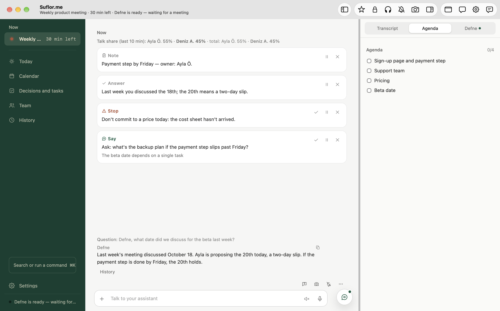
</p>

<p align="center">
  <b>A personal voice assistant that runs on your Mac.</b> It plans your day, whispers to you in meetings, keeps track of your tasks and emails, and knows your project.
</p>

<p align="center">
  
  
  
  
</p>

<p align="center">
  <a href="#installation">Installation</a> ·
  <a href="#through-the-day">Through the day</a> ·
  <a href="#live-data-on-a-card-as-the-meeting-unfolds">In meetings</a> ·
  <a href="#privacy">Privacy</a> ·
  <a href="KILAVUZ.md">Guide (Turkish)</a>
</p>

---

In theatre, the prompter (*suflör* in Turkish) whispers the line an actor has forgotten from the wings. Suflor.me started out doing that in
meetings; today it is a personal assistant that stays with you through the day. You give it a name and talk to it by text or voice. The more
you use it, the better it knows you, your project and your work.

## Through the day

- **Morning:** *Today at a glance* shows what is on your plate: the day's focus, decisions waiting on you, what changed since yesterday.
- **Any time:** hold Option + Shift + Space anywhere on your Mac and ask, or type in the chat panel. It searches the web, drafts emails and adds reminders to your calendar.
- **Email, tasks, calendar:** it lists emails waiting for a reply, syncs your tasks to Mac Reminders and finds free time in your calendar.
- **In meetings:** it listens, puts the relevant information on a card with its source and, if you like, joins the meeting by voice.
- **After meetings:** a closing round collects decisions and tasks, and open ends are brought up again later.
- **It learns over time:** overnight it reviews your records and writes down what it learned; you mark it *Right* or *Wrong*.

## Today at a glance

In the morning the panel shows what is yours for the day at a glance: the day's focus, items awaiting your decision, and what is marked **New** or **Changed** since yesterday.
Every row has a one-click action beside it: *Approve*, *Done*, *Prepare the draft*. Overnight the assistant also looks through your records and writes down what it learned;
under *What I learned yesterday* you say **Right** or **Wrong**, and that is used next time.

<p align="center">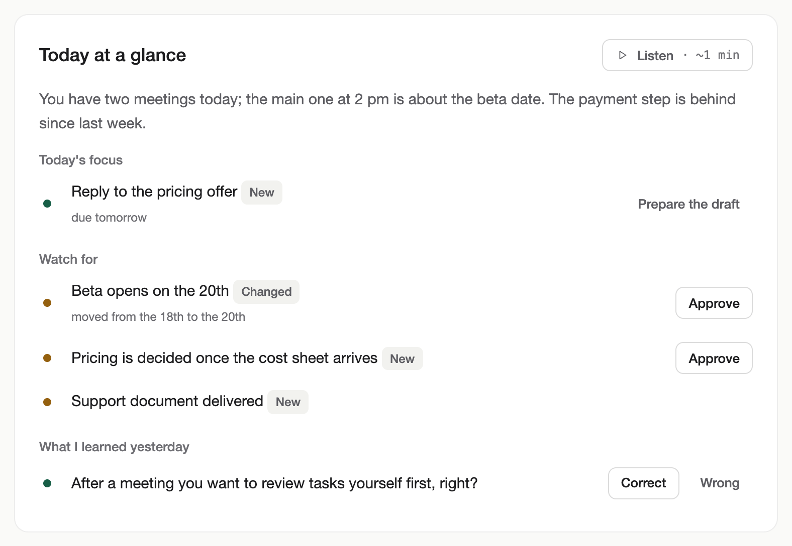</p>

## Call your assistant by name

During setup you give your assistant a name; only that name appears on the panel, on cards and in speech. You type to it or ask
by voice: *"Defne, what date did we discuss for the beta last week?"* The answer arrives on the panel and aloud within seconds.

- **One box:** the same box sits under every view. `+` on the left adds a document, you type in the middle, and you hold the microphone
  on the right to ask by voice. Double-tap the microphone for a hands-free conversation.
- **Work for another session:** say *"Defne, forward this to the project session"* and the message is shown on a confirmation card;
  it is sent only if you approve.
- **Two assistants:** optionally add a second, more relaxed assistant for outside meetings. Turn it on in Settings and the two hear each
  other and join the conversation on their own; the three of you talk together.
- **Choice of AI:** the assistant's brain is Claude by default. Without a Claude subscription you can use a Gemini or OpenAI-compatible API key;
  each job (Talk, translation, project card) can be set separately.
  If the chosen service fails, that job is done once with Claude.
- **Voice:** your Mac's built-in voice, natural Turkish voices that run on your Mac (Pocket) or the optional Gemini voice.

## Live data on a card, as the meeting unfolds

<p align="center">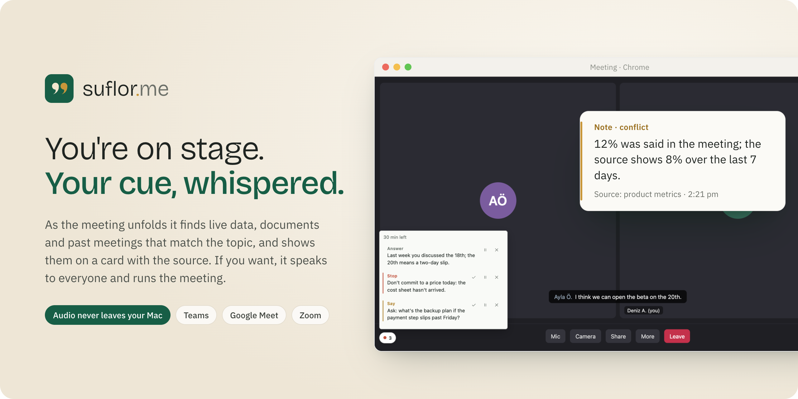</p>

<p align="center"><sub>The Day summary, the chat panel on the right and a meeting card in one window; the data is fictional.</sub></p>

<p align="center">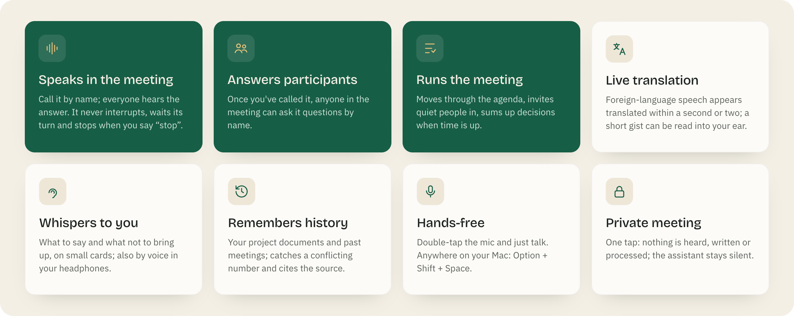</p>

This is the heart of Suflor.me: as the conversation moves, it **finds the information that fits the topic and puts it on a card with its source.** When someone
asks for a number, a date or an earlier decision, the answer reaches you without interrupting the meeting; when a figure said aloud doesn't match the record, it warns you.

<p align="center">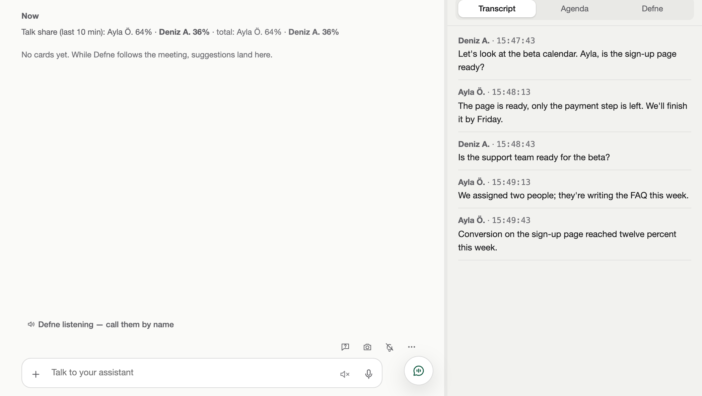</p>
<p align="center"><sub><b>1. Someone speaks.</b> Every sentence flows into the live transcript on the panel, with who said it.</sub></p>

<p align="center">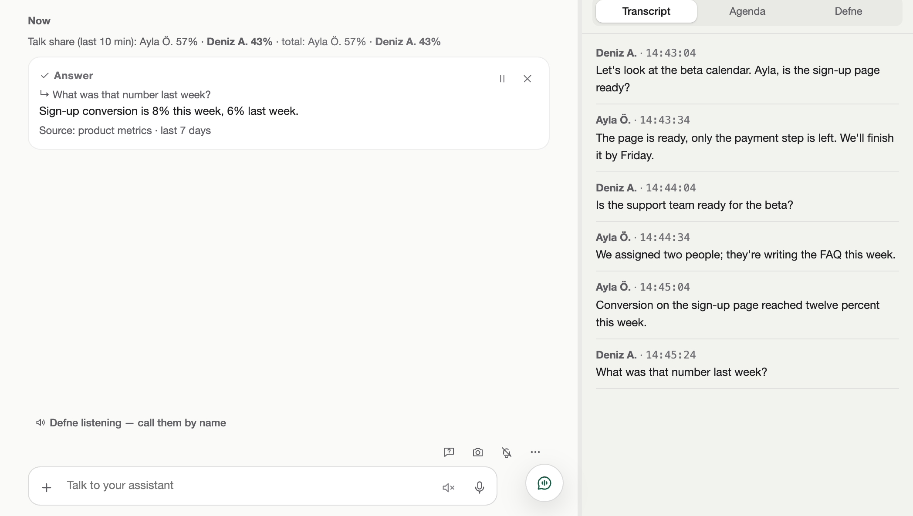</p>
<p align="center"><sub><b>2. A sourced answer in seconds.</b> When a question is asked, an Answer card arrives with the figure, the period and the source (past meeting, project document or live data).</sub></p>

<p align="center">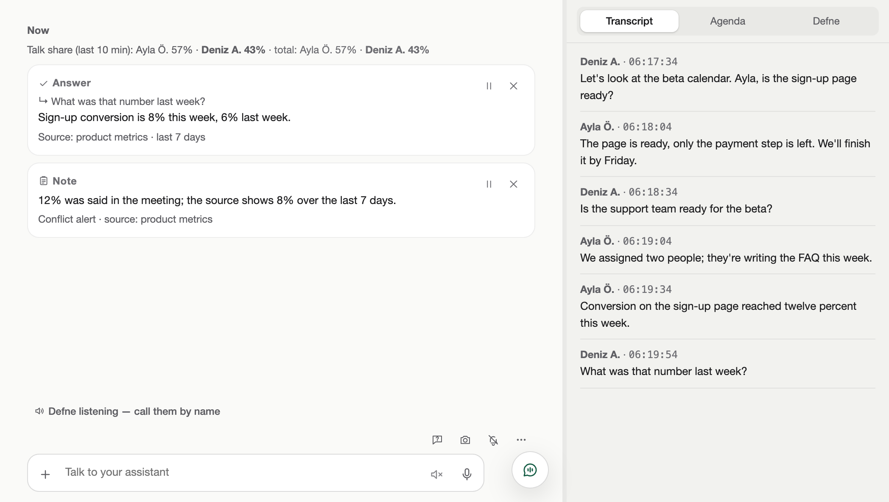</p>
<p align="center"><sub><b>3. A Note if something conflicts.</b> If a figure said in the meeting disagrees with the record, a Note card shows both side by side.</sub></p>

<p align="center">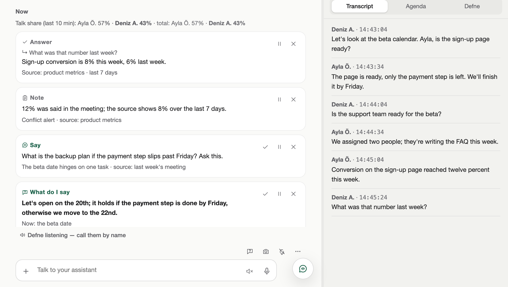</p>
<p align="center"><sub><b>4. Say and What do I say?</b> When you are stuck or there is something worth asking, a one-sentence suggestion card fits the moment.</sub></p>

<p align="center">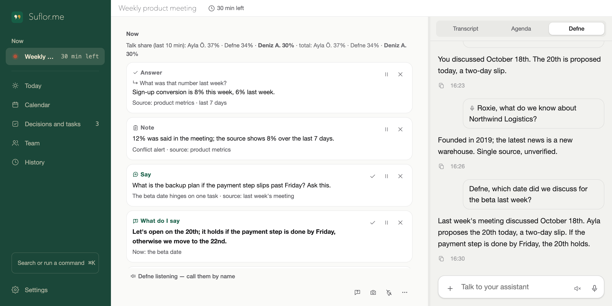</p>
<p align="center"><sub><b>5. Ask the assistant by name.</b> Say "Defne, ..."; the answer appears in writing next to the cards and is read aloud in the meeting; ask Roxie about an outside company.</sub></p>

<p align="center">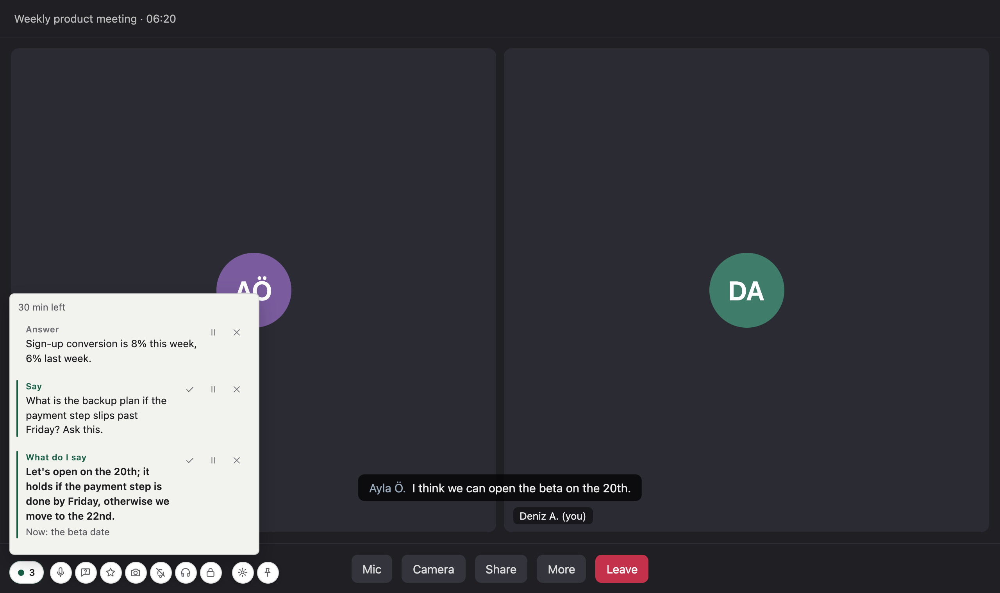</p>
<p align="center"><sub><b>6. The strip on the meeting window.</b> Even with the panel closed, the cards sit in the corner of the meeting screen; tap to dismiss.</sub></p>

### Where you see the cards

The same cards show up in three places; you decide which one to keep open.

<p align="center">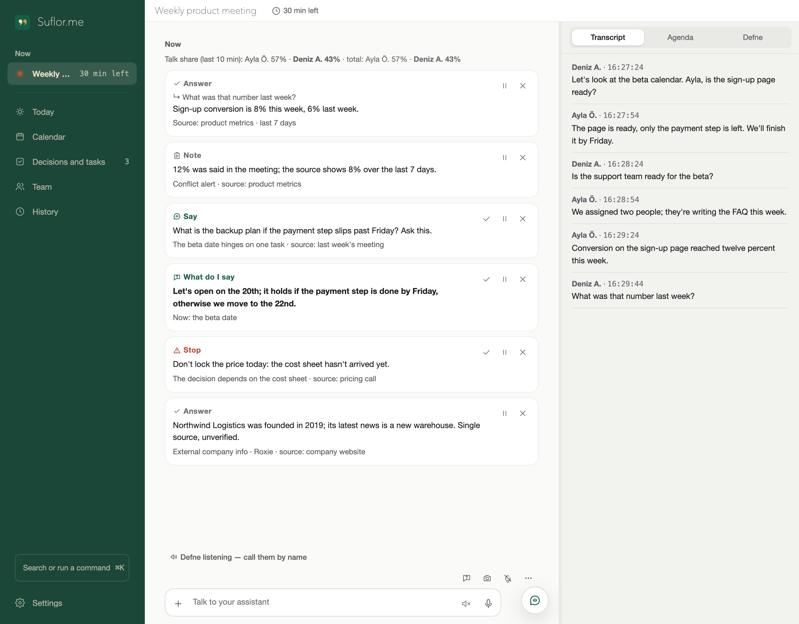</p>
<p align="center"><sub><b>In the full panel.</b> In the Mac window or in Chrome: cards in the middle, live transcript and the assistant chat on the right.</sub></p>

<p align="center">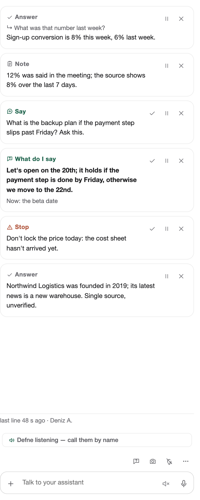</p>
<p align="center"><sub><b>In the side panel.</b> The small panel stays in a narrow column beside the meeting window; the assistant chat on the right of the full panel (picture 5) keeps the written answers.</sub></p>

<p align="center"></p>
<p align="center"><sub><b>Cards only on screen.</b> With no panel open, the strip in the corner of the meeting window shows the cards; the three small buttons are done, later, not needed.</sub></p>

- **Answers with a source:** when you ask *"What was that number last week?"* the card gives the figure, the period and the source. A source can be past meetings,
  project documents (indexed on this Mac) or a live data source you have turned on.
- **Conflict alert:** if a figure, date or responsibility mentioned in the meeting disagrees with an earlier record or with live data, a note puts the two side by side:
  *"12% was said in the meeting; the source shows 8% over the last 7 days."* You make the correction; the assistant never says it aloud.
- **Live data source (optional):** turn on a connector that serves product or campaign metrics in Settings, and the current value is queried when the topic comes up.
  Only a read query goes to the source (metric, period, channel); no names and no transcript quotes. At most one card per topic every ten minutes.
- **When you get stuck:** Option + Shift + O (*What should I say?*) suggests a single sentence that fits the moment.
- **Outside companies and people:** when a new customer, competitor or person comes up, a short card from open sources appears; a single-source fact is marked "unverified".
  Only the name and topic go into the search; it is off in a private meeting.

## It joins the meeting by voice

Suflor.me is not just a note taker. If you want, your assistant joins the meeting: you call it by name and everyone hears the answer.
Once you've called it, the other participants can ask it questions too. You can even hand the whole meeting over to it.

<p align="center">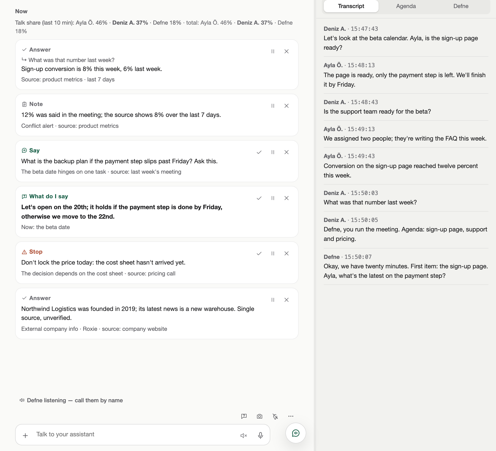</p>

- **Speaks in the meeting:** *"Defne, which tasks are left this week?"* The answer is read aloud for everyone. The assistant never
  interrupts; it waits its turn and stops if someone starts speaking. *"Defne, stop"* or Option + Shift + S silences it at once.
  Turn it on in Settings → Assistants speak in meetings; in a web meeting its voice is mixed into your microphone only while it speaks.
- **Answers participants' questions:** once you've called it, anyone in the meeting can ask *"Defne, …"*. When you want an answer
  only for yourself, use the Talk button on the panel.
- **Runs the meeting:** *"Defne, you run the meeting. Agenda: sign-up page, support and pricing."* It takes the agenda from that
  sentence or from the calendar event. It opens each item, invites quiet people in, gently wraps up long monologues and revives a long
  silence. When time is up it summarises and asks for a decision; at the close it reads out decisions and owners. You can step in at
  any time with *"next item"*, *"more time"*, *"summarize"*, *"hold on"*, *"carry on"* or
  *"I'll take it from here"*.
- **Private meeting:** one tap and Suflor.me hears, writes and processes nothing; the assistant stays silent.

### Two assistants: inside and outside

You can have two assistants. One looks after your tasks and project (inside); the other briefs you on outside companies and people in the meeting (outside; default name Roxie).
Each answers to its own name and speaks in its own voice.

<p align="center">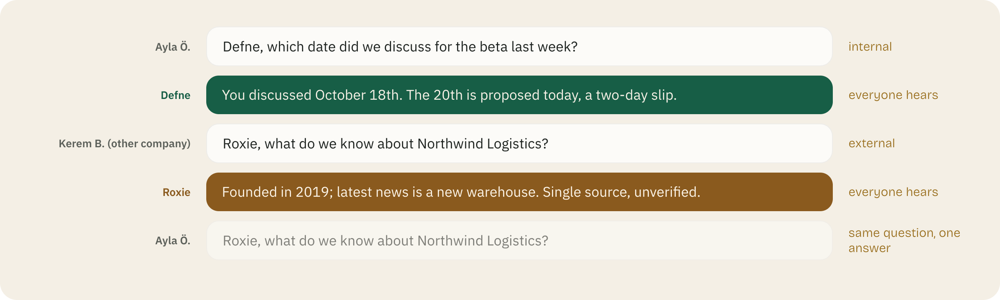</p>

- **The other side can ask too:** once you have called the assistant, everyone in the meeting can ask it by name.
- **One answer per question:** if the same question comes in again right away, it isn't answered twice.
- **It reads the screen too:** when the other side shares a screen, the text on it is added to the assistant's context in batches; you are warned if a password shows.

## It removes the language barrier

- **Live translation:** the other side's words in another language appear translated on the panel, right under each line. In a
  continuous conversation a translation arrives in about a second.
- **Spoken translation:** with headphones on, a short gist of the translation (eight words at most) is read into your ear; the full
  translation stays on the panel. In a browser meeting the other side's audio is lowered meanwhile.
- **Answers in your language:** ask the assistant in English and it answers in English.

## It whispers to you

The assistant follows the meeting and sends four kinds of cards. With the Mac app running they appear as separate boxes at the bottom centre of the screen, over the meeting video; click one to open it, and they are not visible when you share your screen. Without the app they appear in a small strip in the corner of the meeting screen and
on the panel. Three small buttons next to each card: done, later, not needed.

<p align="center">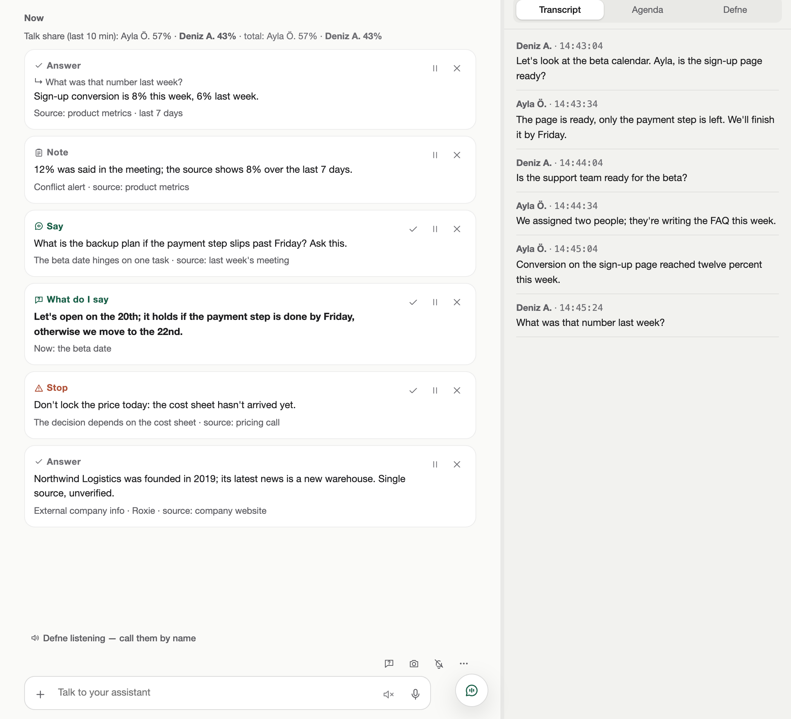</p>

- **Measured:** it speaks more or less depending on your role in the meeting (chair, participant, listener). Unprompted Say and Note
  cards interrupt at most once a minute. **Quiet** sends no cards for 10 minutes.
- **Really whispers (optional):** with headphones on, a Stop card is read into your ear in a short voice; no need to look at the screen.
- **What do I say?:** when you're stuck, one tap (Option + Shift + O) suggests a one-sentence line for the moment.
- **Evidence:** press Option + Shift + K (or say *"kanıt al"*, the Turkish voice command) to save a picture of the meeting screen. While the other
  side is sharing their screen, a picture is saved automatically every time the screen changes. It warns you if a password is visible.
- **Tells you when your name comes up:** when the other side says your name, or when you've been talking for more than ninety
  seconds, the panel shows it right away.

### Three moments of a meeting

| Before | During | After |
|---|---|---|
| **Start** from the calendar. The agenda is set; the project summary, people and open tasks are ready. | Live transcript, cards, translation; if you want, the assistant speaks or runs the meeting. | Summary and meeting output: decisions, tasks with owners and dates, open questions. A mind map by agenda item. PDF or email draft. A closing round lets you settle tasks and decisions in minutes. |

## After the meeting: tasks and decisions

When the meeting ends, the assistant doesn't make you read out every decision and task; it opens a **closing round**: you go through each task with *Done*, *Postpone* or *Later*, and each decision with *Approve*.
What you handled collects in the **Decisions and tasks** panel: tasks with an owner and a date, decisions still open, and tasks assigned to you, all in one place.

<p align="center">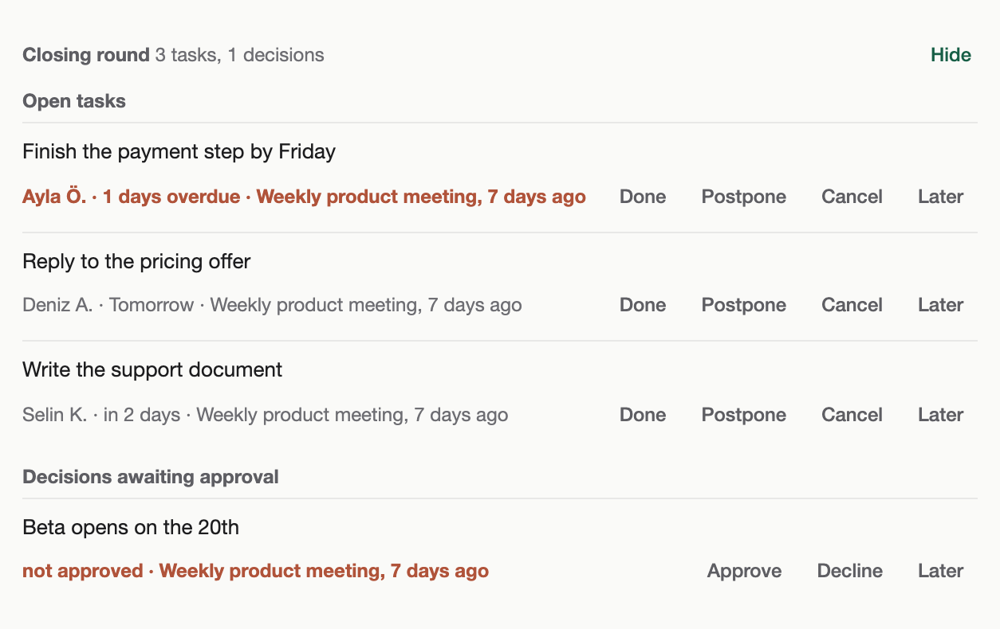</p>

- **Tasks suggested from documents:** if documents added to your project contain work for you or your team, it shows up in the panel as a suggestion; approve it and it becomes a task, reject it and it is forgotten.
- **Open ends after a meeting:** a while after the meeting, if a task is still open or a question unanswered, the assistant gives a short reminder. It never runs in a private meeting.
- **Urgent meeting:** say *"Set up a twenty-minute meeting with Ali today"* and a ready-to-send invitation draft opens for Teams, Meet or Zoom. The invitation never goes out on its own.

## Calendar

The meetings in your Mac Calendar (Google, Exchange, iCloud) appear on the **Calendar** page in the Suflor.me sidebar. No sign-up is needed; it reads your Calendar and never changes it.

<p align="center">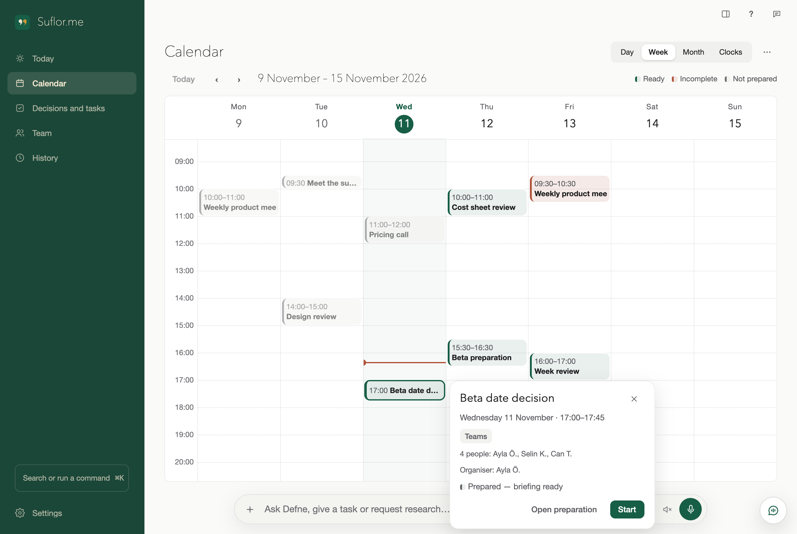</p>

- **Meetings.** Day, Week, Month and Clocks (working hours and outside) views. Click a meeting to see its attendees, platform (Teams, Meet, Zoom) and organiser; **Start** begins the meeting from its link, and for a past meeting with a Suflor record it opens the transcript.
- **Preparation and agenda draft.** Each meeting shows its preparation status by color (Ready, Incomplete, Not prepared). **Open preparation** shows the briefing; open tasks and decisions about the attendees come as an agenda draft (see *Using it in a team*).
- **Finding a free time.** Ask the assistant "when am I free this week?" or "what are my free hours tomorrow?" and it reads the calendar and answers with the free slots inside your working hours (setting `calisma_saatleri`).

## Using it in a team

Suflor.me works fine for one person. In team meetings it does three things: it drafts the agenda, tracks the team's tasks, and, if you want, syncs records with teammates.

**An agenda for the meeting.** For a meeting on your calendar, open tasks, decisions awaiting approval and unanswered questions left over from earlier meetings with the same attendees become an **agenda draft**. You can use it as the agenda in *Start* or copy it.

<p align="center">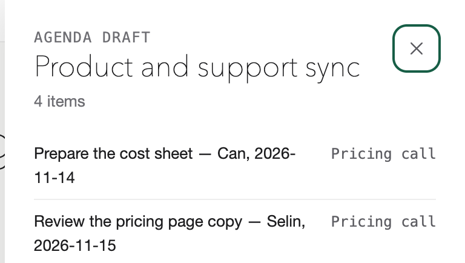</p>

During the meeting the **Agenda** tab in the side panel lists the items; the one being discussed is marked, finished ones are ticked, and the time left is shown.

<p align="center">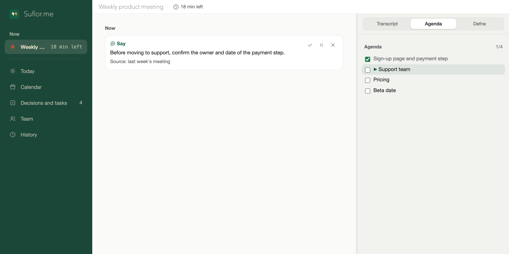</p>

**The team's tasks.** On the *Decisions and tasks* page the *Team's* view shows who owns what and by when, who is late, and which decisions are waiting for approval. In the closing round tasks are assigned to their owners; tasks addressed to your team in documents you add to the project are suggested too.

<p align="center">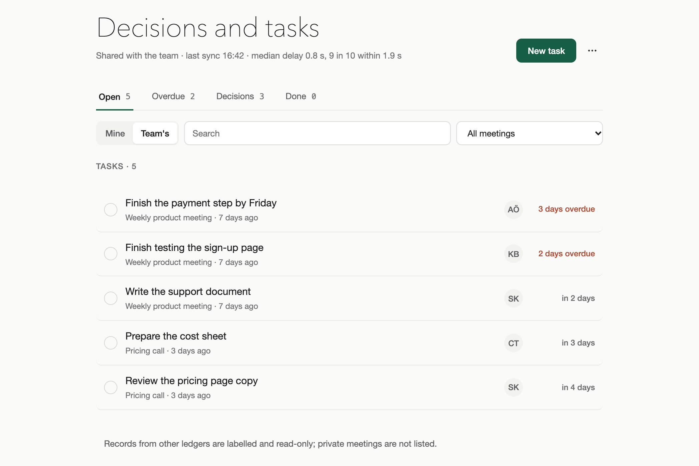</p>

**Team sync (optional).** Teammates who sign in with the same company Google account can sync their records. Everyone sees only the records that concern their own role. The line under the page title shows the last sync and its delay. Setup, invitations and joining go through `ortak_bulut.py` (`kur`, `davet`, `katil`); it is off by default. Meeting audio and transcripts are not synced.

**Other tools.** When a live figure is needed, the information-sources connector fetches metrics read-only. A follow-up e-mail draft is prepared after the meeting and sending is left to you. On the roadmap: task sync with a project-management tool (Basecamp first).

## It remembers your project and its history

During setup you point it to your project folder. Suflor.me converts documents (Word, Pages, PDF, including old .doc and .rtf),
presentations (PowerPoint, Keynote), spreadsheets (Excel, Numbers, CSV) and images to text on this Mac and indexes them. Search goes beyond keywords: it finds passages close in meaning even when the words in your question never appear in the document.

<p align="center">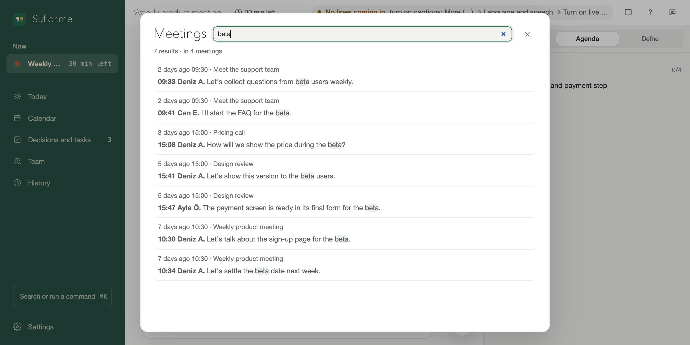</p>

- **Spreadsheets and the project card in one database:** Excel, Numbers and CSV sheets go into a small database on this Mac. For questions
  like "How much did we spend this month?" or "How many open items are there?", the assistant computes the answer instead of eyeballing
  rows, and names the source file. The project card you approve during setup (people, decisions, open items, each with its source) lives
  there too. The knowledge sits in a standard database, not in a file tied to one AI. The database is never written to your project folder.
- **Catches contradictions:** if a claim, number or responsibility in the conversation differs from an earlier document or meeting,
  it tells you, with the source.
- **Decision graph:** decisions and claims accumulate on this Mac. If the same person gives a different number at the next meeting,
  it's noticed.
- **Meetings window:** all transcripts in one place; search across transcripts and summaries, and a result opens the matching line.
- **A dictionary that learns:** names and terms that are mis-transcribed become dictionary candidates as you correct them or the assistant notices; once you approve, they come out right in the next meeting. You can undo any of them.
- **Speaker names:** names from the meeting app's captions are matched to each person's voiceprint on this Mac. Even without captions
  (desktop meeting, a recording dropped in later) the speaker's name is found.

## Privacy

Suflor.me was built around one rule from day one: **audio never leaves your Mac.** Speech recognition, voiceprints, document
conversion and search all run on this Mac.

<p align="center">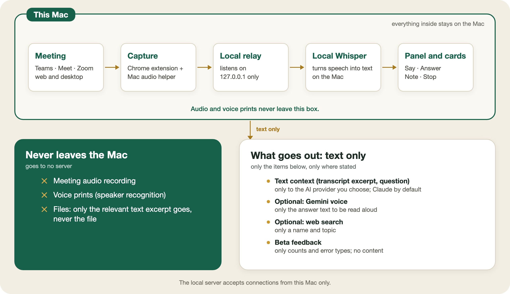</p>

- Suflor.me's local server only accepts connections from this Mac (`127.0.0.1`). Audio and voice prints never go to any server; text goes only to the AI you choose.
- The text sent to Claude goes through your own Claude Code session; Anthropic's terms of use apply.
- If you pick another service instead of Claude, the text context (transcript, notes, document passages) goes to that service; audio does not.
- The beta is voluntary development participation and can't be turned off. A copy of every package sent is kept in
  `~/Library/Application Support/Suflor/teshis/gonderilen/`, so you can read exactly what was sent.
- Meeting files stay in your project folder. They contain people's names; treat them as internal documents.

## Where it works

| Meeting | How |
|---|---|
| Microsoft Teams, Google Meet (web) | With the Chrome extension |
| Zoom (web) | Not for now — use the Zoom desktop app |
| Teams and Zoom desktop apps | With the Suflor.me Mac app (menu bar) |

The panel opens in two places: in the Suflor.me Mac app's window or in Chrome. The Mac window has a sidebar (Now · Today · Archive),
separate Settings and Help windows, and light/dark themes. The interface is available in Turkish and English.

## Installation

**1.** Paste into Terminal:

```bash
curl -fsSL https://raw.githubusercontent.com/suflorme/suflor/main/kur.sh | bash
```

**2.** The setup wizard opens in your browser. One task per screen: Mac check, AI connection (Claude or API key), your name, the assistant's name and
voice, project folder, model downloads, calendar and the Chrome extension. The wizard checks every step itself. If you close it, the
same command picks up where you left off.

**3.** Join a meeting. Press **Start** in the panel's calendar; the assistant takes it from there.

<p align="center">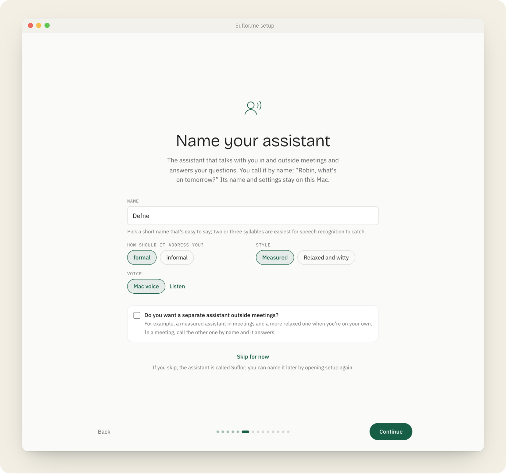</p>

Every release is signed with the developer's key. Installation and updates verify the downloaded code's signature and install nothing
if it doesn't match. When a new version is out, an **Update** button appears on the panel.

**Stuck during installation?** Give a Claude session this repository's link and the error text on screen. Claude reads the install steps, log files and known issues from [KURULUM-YARDIM.md](KURULUM-YARDIM.md) (written for AI assistants, in Turkish).

### Requirements

| What | Required |
|---|---|
| Mac | Apple Silicon (M series), macOS 14 or later |
| Memory | at least 16 GB (about 4 GB in use during a meeting) |
| Disk | about 12 GB free (models about 5 GB; document conversion and search about 3.3 GB) |
| Browser | Google Chrome |
| AI | Recommended: [Claude Code](https://claude.com/claude-code) and a Claude subscription (Pro or higher). The wizard installs Claude Code if needed; sign in once in Terminal with `claude` → `/login`. Alternatives: a Gemini or OpenAI-compatible API key. |

## Shortcuts

| Shortcut | What it does |
|---|---|
| Option + Shift + K | Evidence: saves a picture of the meeting screen (warns if a password is visible; automatic while a screen is shared) |
| Option + Shift + O | What do I say? A one-sentence line |
| Option + Shift + M | Quiet: no cards for 10 minutes |
| Option + Shift + S | Silence the assistant |
| Option + Shift + Space (hold) | Ask the assistant by voice anywhere on your Mac (with the Mac app) |

## More

The detailed guide [KILAVUZ.md](KILAVUZ.md) (in Turkish) covers next steps after installation, project preparation, settings,
voices (Pocket, Gemini), privacy details and the list of components.

## License

MIT, see [LICENSE](LICENSE). Optional voice models are downloaded separately and come with their own licenses
([Guide → Lisanslar](KILAVUZ.md#lisanslar)).
