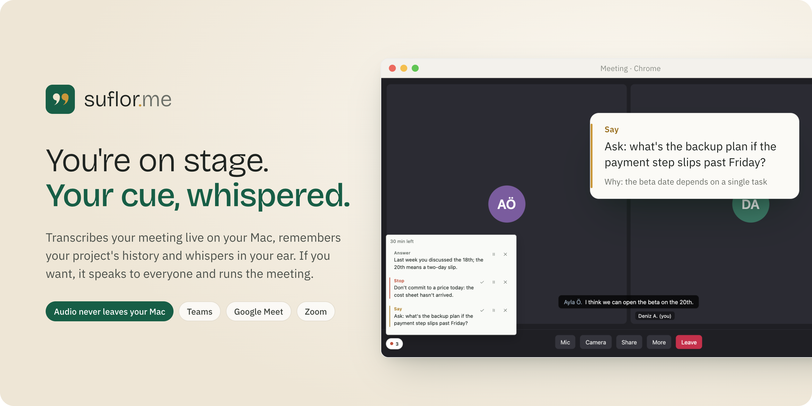
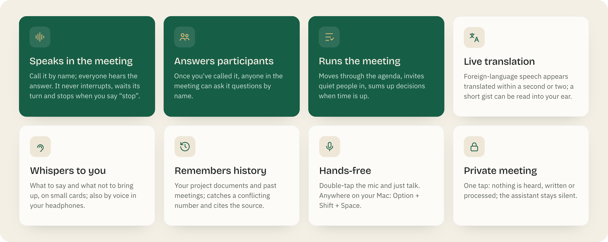
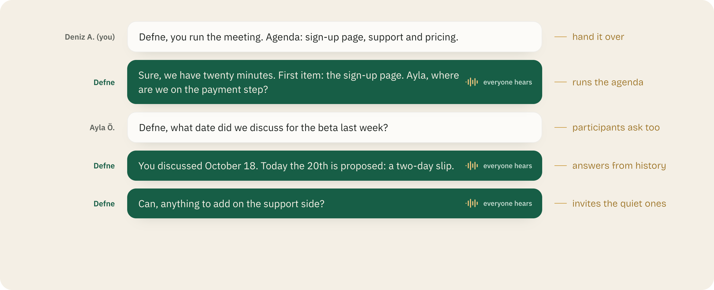
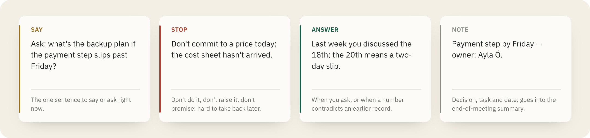
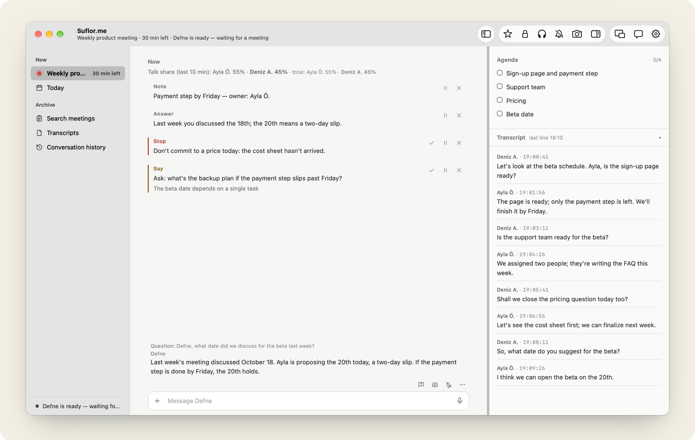
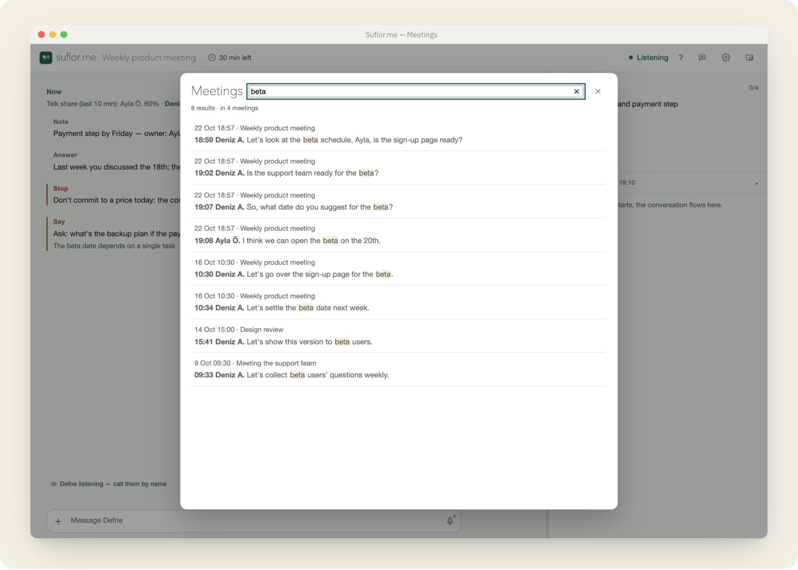
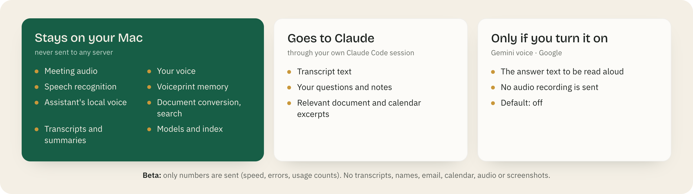
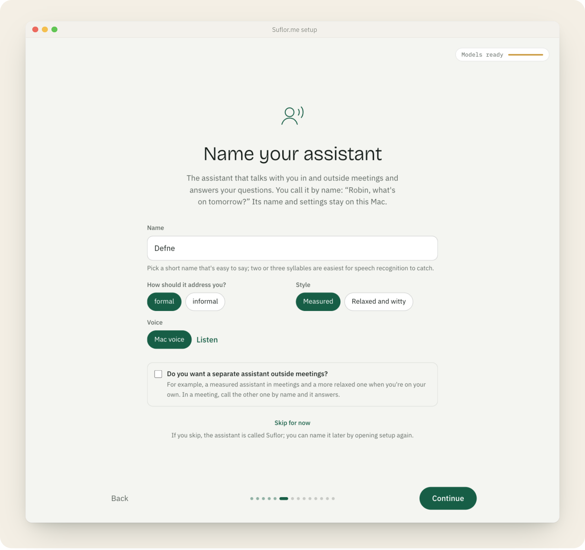

<p align="center">
  <a href="README.md">Türkçe</a> · <b>English</b>
</p>

<p align="center">
  
</p>

<p align="center">
  <b>A voice assistant for your meetings.</b> It runs on your Mac, knows your project and whispers the right line at the right moment.
</p>

<p align="center">
  
  
  
  
</p>

<p align="center">
  <a href="#installation">Installation</a> ·
  <a href="#it-joins-the-meeting-by-voice">Joins the meeting</a> ·
  <a href="#privacy">Privacy</a> ·
  <a href="KILAVUZ.md">Guide (Turkish)</a>
</p>

---

In theatre, the prompter (*suflör* in Turkish) whispers the line an actor has forgotten from the wings. Suflor.me does the same in
your meetings. You focus on the conversation. It listens, remembers your project's history and, when it matters, says one sentence.

<p align="center"></p>

## It joins the meeting by voice

Suflor.me is not just a note taker. If you want, your assistant joins the meeting: you call it by name and everyone hears the answer.
Once you've called it, the other participants can ask it questions too. You can even hand the whole meeting over to it.

<p align="center"></p>

- **Speaks in the meeting:** *"Defne, which tasks are left this week?"* The answer is read aloud for everyone. The assistant never
  interrupts; it waits its turn and stops if someone starts speaking. *"Defne, stop"* or Option + Shift + S silences it at once.
  Turn it on in Settings → Assistants speak in meetings; in a web meeting its voice is mixed into your microphone only while it speaks.
- **Answers participants' questions:** once you've called it, anyone in the meeting can ask *"Defne, …"*. When you want an answer
  only for yourself, use the Talk button on the panel.
- **Runs the meeting:** *"Defne, you run the meeting. Agenda: sign-up page, support and pricing."* It takes the agenda from that
  sentence or from the calendar event. It opens each item, invites quiet people in, gently wraps up long monologues and revives a long
  silence. When time is up it summarises and asks for a decision; at the close it reads out decisions and owners. You can step in at
  any time with *"next item"*, *"more time"*, *"summarize"*, *"hold on"*, *"carry on"* or
  *"I'll take it from here"*.
- **Private meeting:** one tap and Suflor.me hears, writes and processes nothing; the assistant stays silent.

## It removes the language barrier

- **Live translation:** the other side's words in another language appear translated on the panel, right under each line. In a
  continuous conversation a translation arrives in about a second.
- **Spoken translation:** with headphones on, a short gist of the translation (eight words at most) is read into your ear; the full
  translation stays on the panel. In a browser meeting the other side's audio is lowered meanwhile.
- **Answers in your language:** ask the assistant in English and it answers in English.

## It whispers to you

The assistant follows the meeting and sends four kinds of cards. They appear in a small strip in the corner of the meeting screen and
on the panel. Three small buttons next to each card: done, later, not needed.

<p align="center"></p>

- **Measured:** it speaks more or less depending on your role in the meeting (chair, participant, listener). Unprompted Say and Note
  cards interrupt at most once a minute. **Quiet** sends no cards for 10 minutes.
- **Really whispers (optional):** with headphones on, a Stop card is read into your ear in a short voice; no need to look at the screen.
- **What do I say?:** when you're stuck, one tap (Option + Shift + O) suggests a one-sentence line for the moment.
- **Evidence:** press Option + Shift + K (or say *"kanıt al"*, the Turkish voice command) to save a picture of the meeting screen. While the other
  side is sharing their screen, a picture is saved automatically every time the screen changes. It warns you if a password is visible.
- **Tells you when your name comes up:** when the other side says your name, or when you've been talking for more than ninety
  seconds, the panel shows it right away.

### Three moments of a meeting

| Before | During | After |
|---|---|---|
| **Start** from the calendar. The agenda is set; the project summary, people and open tasks are ready. | Live transcript, cards, translation; if you want, the assistant speaks or runs the meeting. | Summary and meeting output: decisions, tasks with owners and dates, open questions. A mind map by agenda item. PDF or email draft. |

## Call your assistant by name

During setup you give your assistant a name; only that name appears on the panel, on cards and in speech. You type to it or ask
by voice: *"Defne, what date did we discuss for the beta last week?"* The answer arrives on the panel and aloud within seconds.

<p align="center"></p>

- **One box:** the same box sits under every view. `+` on the left adds a document, you type in the middle, and you hold the microphone
  on the right to ask by voice. Double-tap the microphone for a hands-free conversation.
- **Work for another session:** say *"Defne, forward this to the project session"* and the message is shown on a confirmation card;
  it is sent only if you approve.
- **Two assistants:** optionally add a second, more relaxed assistant for outside meetings. Turn it on in Settings and the two hear each
  other and join the conversation on their own; the three of you talk together.
- **Choice of AI:** the assistant's brain is Claude by default. Without a Claude subscription you can use a Gemini or OpenAI-compatible API key,
  or a local model on your Mac (Ollama) to work without the internet; each job (Talk, translation, project card) can be set separately.
  If the chosen service fails, that job is done once with Claude.
- **Voice:** your Mac's built-in voice, natural Turkish voices that run on your Mac (Pocket) or the optional Gemini voice.

## It remembers your project and its history

During setup you point it to your project folder. Suflor.me converts documents (Word, Pages, PDF, including old .doc and .rtf),
presentations (PowerPoint, Keynote), spreadsheets (Excel, Numbers, CSV) and images to text on this Mac and indexes them. Search goes beyond keywords: it finds passages close in meaning even when the words in your question never appear in the document.

<p align="center"></p>

- **Spreadsheets and the project card in one database:** Excel, Numbers and CSV sheets go into a small database on this Mac. For questions
  like "How much did we spend this month?" or "How many open items are there?", the assistant computes the answer instead of eyeballing
  rows, and names the source file. The project card you approve during setup (people, decisions, open items, each with its source) lives
  there too. The knowledge sits in a standard database, not in a file tied to one AI. The database is never written to your project folder.
- **Catches contradictions:** if a claim, number or responsibility in the conversation differs from an earlier document or meeting,
  it tells you, with the source.
- **Decision graph:** decisions and claims accumulate on this Mac. If the same person gives a different number at the next meeting,
  it's noticed.
- **Meetings window:** all transcripts in one place; search across transcripts and summaries.
- **Speaker names:** names from the meeting app's captions are matched to each person's voiceprint on this Mac. Even without captions
  (desktop meeting, a recording dropped in later) the speaker's name is found.

## Privacy

Suflor.me was built around one rule from day one: **audio never leaves your Mac.** Speech recognition, voiceprints, document
conversion and search all run on this Mac.

<p align="center"></p>

- Suflor.me's local server only accepts connections from this Mac (`127.0.0.1`). Meeting content is not sent to any server.
- The text sent to Claude goes through your own Claude Code session; Anthropic's terms of use apply.
- If you pick another service instead of Claude, the text context (transcript, notes, document passages) goes to that service; audio does not.
  With a local model the text never leaves your Mac either.
- The beta is voluntary development participation and can't be turned off. A copy of every package sent is kept in
  `~/Library/Application Support/Suflor/teshis/gonderilen/`, so you can read exactly what was sent.
- Meeting files stay in your project folder. They contain people's names; treat them as internal documents.

## Where it works

| Meeting | How |
|---|---|
| Microsoft Teams, Google Meet (web) | With the Chrome extension |
| Zoom (web) | With the Chrome extension (experimental) |
| Teams and Zoom desktop apps | With the Suflor.me Mac app (menu bar) |

The panel opens in two places: in the Suflor.me Mac app's window or in Chrome. The Mac window has a sidebar (Now · Today · Archive),
separate Settings and Help windows, and light/dark themes. The interface is available in Turkish and English.

## Installation

**1.** Paste into Terminal:

```bash
curl -fsSL https://raw.githubusercontent.com/suflorme/suflor/main/kur.sh | bash
```

**2.** The setup wizard opens in your browser. One task per screen: Mac check, AI connection (Claude, API key or local model), your name, the assistant's name and
voice, project folder, model downloads, calendar and the Chrome extension. The wizard checks every step itself. If you close it, the
same command picks up where you left off.

**3.** Join a meeting. Press **Start** in the panel's calendar; the assistant takes it from there.

<p align="center"></p>

Every release is signed with the developer's key. Installation and updates verify the downloaded code's signature and install nothing
if it doesn't match. When a new version is out, an **Update** button appears on the panel.

### Requirements

| What | Required |
|---|---|
| Mac | Apple Silicon (M series), macOS 14 or later |
| Memory | at least 16 GB (about 4 GB in use during a meeting) |
| Disk | about 12 GB free (models about 5 GB; document conversion and search about 3.3 GB) |
| Browser | Google Chrome |
| AI | Recommended: [Claude Code](https://claude.com/claude-code) and a Claude subscription (Pro or higher). The wizard installs Claude Code if needed; sign in once in Terminal with `claude` → `/login`. Alternatives: a Gemini or OpenAI-compatible API key, or a local model on your Mac (Ollama, ~3–7 GB; weak in Turkish, best as a fallback). |

## Shortcuts

| Shortcut | What it does |
|---|---|
| Option + Shift + K | Evidence: saves a picture of the meeting screen (warns if a password is visible; automatic while a screen is shared) |
| Option + Shift + O | What do I say? A one-sentence line |
| Option + Shift + M | Quiet: no cards for 10 minutes |
| Option + Shift + S | Silence the assistant |
| Option + Shift + Space (hold) | Ask the assistant by voice anywhere on your Mac (with the Mac app) |

## More

The detailed guide [KILAVUZ.md](KILAVUZ.md) (in Turkish) covers next steps after installation, project preparation, settings,
voices (Pocket, Piper, Gemini), privacy details and the list of components.

## License

MIT, see [LICENSE](LICENSE). Optional voice models are downloaded separately and come with their own licenses
([Guide → Lisanslar](KILAVUZ.md#lisanslar)).
