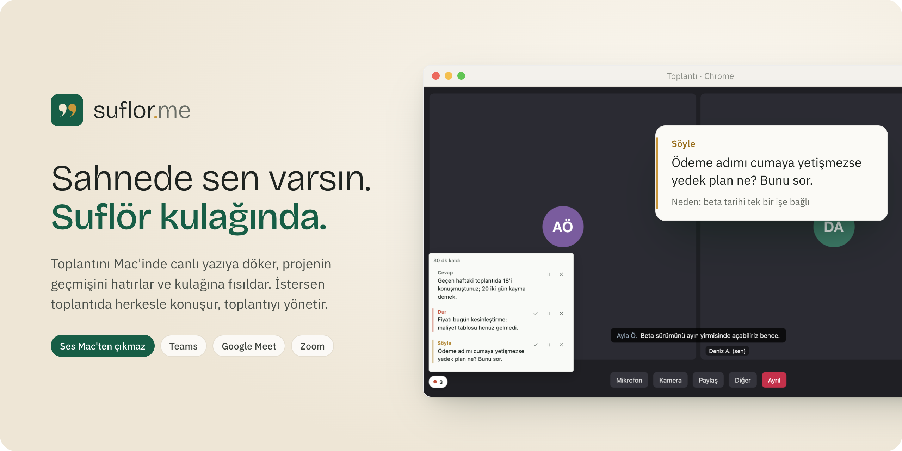
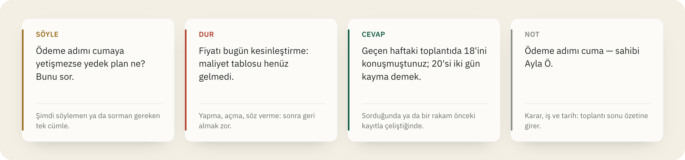
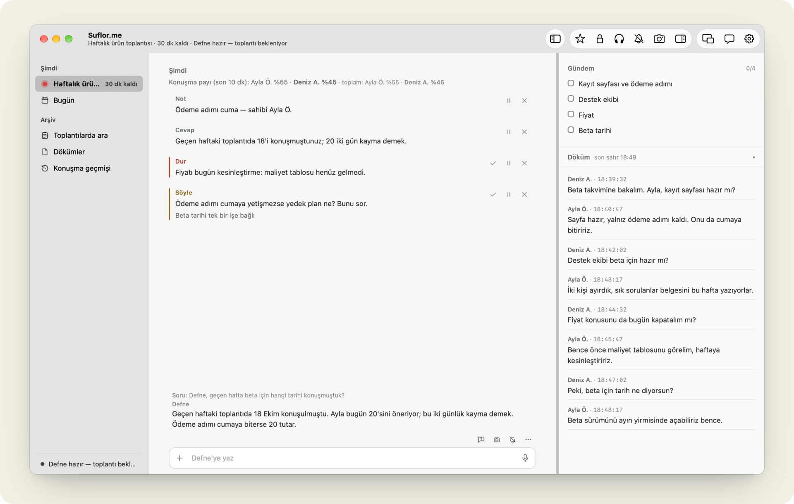
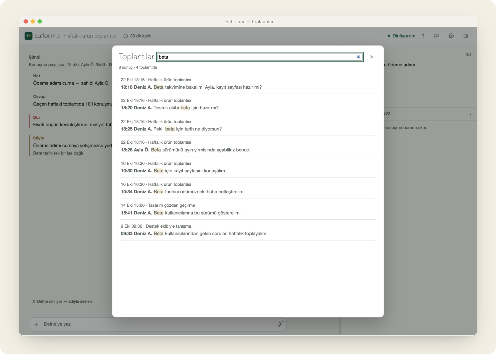
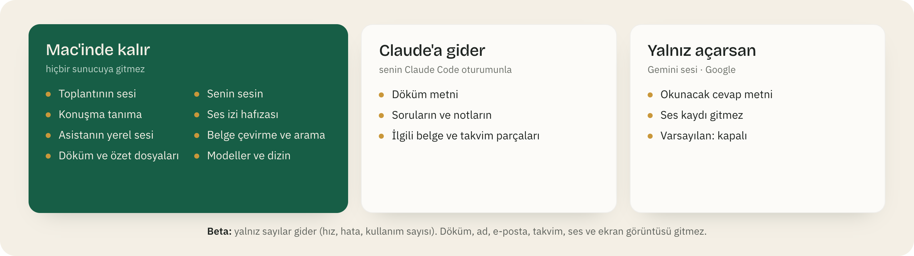
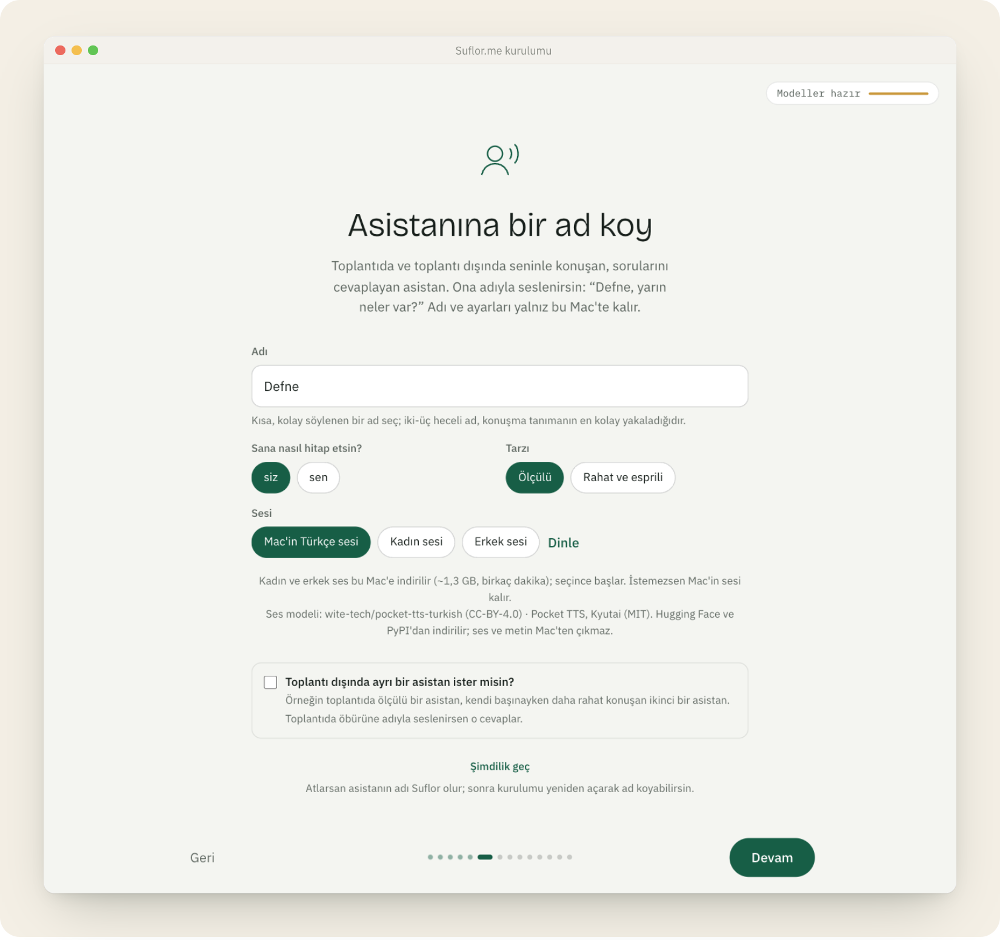

<p align="center">
  
</p>

<p align="center">
  <b>Toplantıların için sesli asistan.</b> Mac'inde çalışır, projeni bilir, doğru anda kulağına fısıldar.
</p>

<p align="center">
  
  
  
  
</p>

<p align="center">
  <a href="#kurulum">Kurulum</a> ·
  <a href="#toplantıda-ne-olur">Toplantıda ne olur</a> ·
  <a href="#gizlilik">Gizlilik</a> ·
  <a href="KILAVUZ.md">Kılavuz</a>
</p>

---

Tiyatroda suflör, oyuncu repliğini unuttuğunda kulisten fısıldayan kişidir. Suflor.me toplantıda aynı işi yapar. Sen konuşmaya
odaklanırsın. O dinler, projenin geçmişini hatırlar ve gerektiğinde tek bir cümle söyler.

<table>
<tr>
<td valign="top" width="33%"><b>Dinler</b><br>Senin sesini ve karşı tarafın sesini Mac'inde, canlı olarak yazıya döker. Ses diske yazılmaz, Mac'ten çıkmaz.</td>
<td valign="top" width="33%"><b>Hatırlar</b><br>Projenin belgelerini ve geçmiş toplantıları bilir. Bugün söylenen bir rakam geçen haftakiyle çelişirse fark eder.</td>
<td valign="top" width="33%"><b>Fısıldar</b><br>Ne sorman, neyi açmaman, neyi not etmen gerektiğini küçük kartlarla söyler. Adıyla seslenirsen cevap verir.</td>
</tr>
</table>

## Toplantıda ne olur

Asistan toplantıyı izler ve dört tür kart gönderir. Kartlar toplantı ekranının köşesindeki küçük şeritte ve panoda belirir.
Kartın yanındaki üç küçük düğme: yaptım, sonraya bırak, gerek yok.

<p align="center"></p>

Asistan araya girmeyi ölçülü yapar. Toplantıdaki rolüne (yöneten, katılımcı, dinleyici) göre az ya da çok konuşur. Kendiliğinden gelen
Söyle ve Not kartları dakikada en çok bir kez araya girer. **Sessiz** düğmesi 10 dakika boyunca hiç kart göndermez.

### Bir toplantının üç anı

| Önce | Sırasında | Sonra |
|---|---|---|
| Takvimden **Başlat**. Gündem kurulur; projenin özeti, kişiler ve açık işler hazır olur. | Canlı döküm, kartlar, **Ne diyeyim?** (tek cümlelik replik önerisi), **Kanıt** (toplantı ekranının görüntüsü), sesli çeviri. | Özet ve toplantı çıktısı: kararlar, sahibi ve tarihi belli işler, açık kalanlar. Gündeme göre zihin haritası. PDF ya da e-posta taslağı. |

## Asistanına adıyla seslen

Kurulumda asistanına bir ad koyarsın; panoda, kartlarda ve seste yalnız o ad geçer. Ona yazarsın ya da sesle sorarsın:
*"Defne, geçen hafta beta için hangi tarihi konuşmuştuk?"* Cevap birkaç saniye içinde panoda ve sesli olarak gelir.

<p align="center"></p>

- **Tek kutu:** her görünümün altında aynı kutu var. Solda `+` belge ekler, ortaya yazarsın, sağdaki mikrofona basılı tutarak sorarsın.
  Mikrofona iki kez dokunursan eller serbest sohbet başlar.
- **Toplantıda konuşabilir (isteğe bağlı):** açarsan asistan cevabını herkesin duyacağı şekilde okur. Sözü kesmez, sırasını bekler.
  *"Defne, dur"* ya da Option + Shift + S onu susturur.
- **İki asistan:** istersen toplantı dışında daha rahat konuşan ikinci bir asistan eklersin.
- **Ses:** Mac'in Türkçe sesi, Mac'te çalışan doğal Türkçe kadın ve erkek sesi (Pocket) ya da isteğe bağlı Gemini sesi.

## Projeni ve geçmişini hatırlar

Kurulumda proje klasörünü gösterirsin. Suflor.me klasördeki belgeleri, sunumları ve PDF'leri bu Mac'te metne çevirir ve dizinler.
Arama sözcükle sınırlı değildir. Soruda geçen sözcük belgede hiç geçmese de anlamca yakın parçayı bulur.

<p align="center"></p>

- **Çelişkiyi yakalar:** konuşmada geçen bir iddia, rakam ya da sorumluluk daha önceki bir belgede ya da toplantıda farklı geçiyorsa
  kaynağıyla söyler.
- **Karar grafı:** kararlar ve iddialar bu Mac'te birikir. Aynı kişi bir sonraki toplantıda farklı bir rakam söylerse fark edilir.
- **Toplantılar penceresi:** bütün dökümler tek yerde; dökümlerde ve özetlerde arama yapılır.
- **Konuşmacı adları:** toplantı uygulamasının altyazısındaki adlar, kişinin ses iziyle bu Mac'te eşleştirilir. Altyazı olmadığında da
  (masaüstü toplantı, sonradan yüklenen kayıt) konuşanın adı bulunur.

## Gizlilik

Suflor.me baştan bu kuralla yazıldı: **ses Mac'inden çıkmaz.** Konuşma tanıma, ses izi, belge çevirme ve arama bu Mac'te çalışır.

<p align="center"></p>

- Suflor.me'nin yerel sunucusu yalnız bu Mac'ten gelen bağlantıyı kabul eder (`127.0.0.1`). Toplantı içeriği hiçbir sunucuya gönderilmez.
- Claude'a giden metni senin Claude Code oturumun görür; Anthropic'in kullanım koşulları geçerlidir.
- Beta sürümü gönüllü geliştirme katılımıdır ve kapatılmaz. Giden her paketin kopyası
  `~/Library/Application Support/Suflor/teshis/gonderilen/` altında durur; neyin gittiğini kendin okuyabilirsin.
- Toplantı dosyaları senin proje klasöründe durur. Kişi adı içerirler; iç belge gibi davran.

Ayrıntı: [Kılavuz → Gizlilik ayrıntıları](KILAVUZ.md#gizlilik-ayrıntıları).

## Nerede çalışır

| Toplantı | Nasıl |
|---|---|
| Microsoft Teams, Google Meet (web) | Chrome eklentisiyle |
| Zoom (web) | Chrome eklentisiyle (deneme aşamasında) |
| Teams ve Zoom masaüstü uygulaması | Suflor.me Mac uygulamasıyla (menü çubuğu) |

Pano iki yerde açılır: Suflor.me Mac uygulamasının penceresinde ya da Chrome'da. Mac penceresinde kenar çubuğu (Şimdi · Bugün · Arşiv),
ayrı Ayarlar ve Yardım pencereleri ve açık/koyu tema var.

## Kurulum

**1.** Terminal'e yapıştır:

```bash
curl -fsSL https://raw.githubusercontent.com/suflorme/suflor/main/kur.sh | bash
```

**2.** Kurulum sihirbazı tarayıcıda açılır. Her ekranda tek iş var: Mac denetimi, Claude bağlantısı, senin adın,
asistanın adı ve sesi, proje klasörü, modellerin indirilmesi, takvim ve Chrome eklentisi. Sihirbaz her adımı kendisi denetler. Kapatırsan aynı komut kaldığın yerden sürdürür.

**3.** Bir toplantıya katıl. Panodaki takvimden **Başlat**'a bas; gerisini asistan yürütür.

<p align="center"></p>

Her yayın geliştiricinin anahtarıyla imzalıdır. Kurulum ve güncelleme indirilen kodun imzasını doğrular; tutmazsa hiçbir şey kurmaz.
Yeni sürüm çıkınca panoda **Güncelle** düğmesi belirir.

### Gerekenler

| Ne | Gereken |
|---|---|
| Mac | Apple Silicon (M serisi), macOS 14 ya da üstü |
| Bellek | en az 16 GB (toplantı sırasında ~4 GB kullanılır) |
| Disk | ~12 GB boş alan (modeller ~5 GB; belge çevirme ve arama ~3,3 GB) |
| Tarayıcı | Google Chrome |
| Claude | [Claude Code](https://claude.com/claude-code) ve Claude aboneliği (Pro ya da üstü). Claude Code yoksa sihirbaz kurar; Terminal'de `claude` → `/login` ile giriş gerekir. |

## Kısayollar

| Kısayol | Ne yapar |
|---|---|
| Option + Shift + K | Kanıt: toplantı ekranının görüntüsünü kaydeder (ekranda şifre görünürse uyarır) |
| Option + Shift + O | Ne diyeyim? Tek cümlelik replik önerisi |
| Option + Shift + M | Sessiz: 10 dakika kart yok |
| Option + Shift + S | Asistan sussun |
| Option + Shift + Boşluk (basılı tut) | Mac'in her yerinde asistana sesle sor (Mac uygulamasıyla) |

## Daha fazlası

[KILAVUZ.md](KILAVUZ.md) içinde: kurulumdan sonraki adımlar, proje hazırlığı, ayarlar, sesler (Pocket, Piper, Gemini), gizlilik ayrıntıları
ve bileşenlerin listesi.

## Lisans

MIT, ayrıntı [LICENSE](LICENSE). İsteğe bağlı indirilen ses modelleri kendi lisanslarıyla gelir ([Kılavuz → Lisanslar](KILAVUZ.md#lisanslar)).
